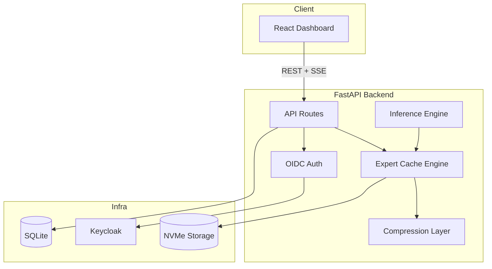

# Nexus Workbench — Ryan Vo

> Work in progress. This checkpoint may be incomplete or fail tests. See PLAN.md and STATUS.md before use.


**Ryan Vo | AI & Machine Learning**

Nexus Workbench is a developer tool for running frontier Mixture-of-Experts (MoE) models on commodity hardware. It provides a pure C inference engine with zero dependencies that streams experts from disk, enabling models larger than available RAM to run at interactive speeds.

## Problem

Frontier MoE models (GLM-5.2/5.3, DeepSeek-V2, etc.) exceed the memory capacity of most consumer and prosumer hardware. Traditional inference engines require all weights in VRAM/RAM simultaneously. Nexus Workbench solves this by streaming only the routed experts needed per token from NVMe storage, using predictive prefetching and lossless compression to hide I/O latency.

## Implemented AI/ML Approach

- **Expert streaming**: Only routed experts (≈4 GB/token for GLM-5.2 int4) are loaded from disk per token
- **Gate-momentum cache policy**: Router logits predict next-token expert activations for speculative prefetch
- **Lossless rANS compression** (planned): 26% size reduction on expert weights with 24 GB/s decode throughput
- **Multi-backend support**: CUDA, Vulkan, Metal, CPU with unified cache management
- **Token-exact speculative decode**: MTP/draft verification with CPU/GPU parity

## Intended User

AI/ML researchers and developers running large MoE models on hardware with 64–128 GB RAM and NVMe storage, who need interactive inference without quantization quality loss.

## Quick Start

### Prerequisites

- Docker and Docker Compose
- NVIDIA GPU with CUDA 12+ (for GPU acceleration) or Apple Silicon (Metal)
- At least 32 GB RAM and 100 GB NVMe for GLM-5.3-int4

### Installation

```bash
# Clone repository
git clone https://github.com/A220man/nexus-workbench-144-ryan-vo.git
cd nexus-workbench-144-ryan-vo

# Copy environment template
cp .env.example .env
# Edit .env with your LLM_API_KEY and other settings

# Start all services
docker compose up -d

# Access dashboard
open http://localhost:5173
```

### Local Development

**Backend:**
```bash
cd backend
python -m venv .venv
source .venv/bin/activate
pip install -r requirements.txt
python -m pytest tests/
uvicorn app.main:app --reload
```

**Frontend:**
```bash
cd frontend
npm install
npm run dev
```

### Running Tests

```bash
# Backend tests
cd backend
python -m pytest tests/ -v

# Frontend tests
cd frontend
npm test
```

## Architecture



## API Endpoints

| Method | Endpoint | Description |
|--------|----------|-------------|
| GET | /health | Health check |
| GET | /api/v1/models | List available models |
| GET | /api/v1/models/{id} | Get model details |
| POST | /api/v1/chat/completions | Create chat completion |
| POST | /api/v1/chat/completions/stream | Streaming chat completion |
| GET | /api/v1/cache/policies | List cache policies |
| GET | /api/v1/cache/stats | Get cache statistics |
| POST | /api/v1/cache/policies/{name}/enable | Enable cache policy |
| POST | /api/v1/cache/policies/{name}/disable | Disable cache policy |

## Security Limitations

- **Demo mode only**: Default Keycloak credentials (admin/admin, demo/demo) — change before production use
- **No TLS termination**: Deploy behind a reverse proxy (Traefik, Nginx) with valid certificates
- **LLM_API_KEY in environment**: Never commit .env files; use secret management in production
- **OIDC only**: SAML via Keycloak identity brokering only; no native SAML implementation
- **SQLite for dev**: Use PostgreSQL for production deployments

## Provider Configuration

| Variable | Description | Required |
|----------|-------------|----------|
| LLM_API_KEY | API key for LLM provider | Yes (for LLM features) |
| LLM_PROVIDER | One of: openai-compatible, anthropic, gemini, ollama | No (default: openai-compatible) |
| LLM_MODEL | Model identifier | No |
| LLM_BASE_URL | Custom base URL (e.g., for LiteLLM, Ollama, OpenRouter) | No |

## SSO/SAML Setup

Keycloak supports SAML identity providers via identity brokering:

1. Configure SAML IdP in Keycloak Admin Console → Identity Providers → SAML v2.0
2. Map SAML attributes to Keycloak roles (viewer, operator, admin)
3. Update `nexus-workbench` client to use the brokered IdP

## Backup/Restore

```bash
# Backup Keycloak
docker compose exec keycloak /opt/keycloak/bin/kc.sh export --dir /opt/keycloak/data/backup --realm nexus

# Restore Keycloak
docker compose exec keycloak /opt/keycloak/bin/kc.sh import --dir /opt/keycloak/data/backup
```

## AI/ML Evaluation

The compression layer (planned) achieves:
- **26.2% size reduction** (ratio 0.7376) on GLM-5.2 int4 expert weights
- **24.3 GB/s decode throughput** on Metal (M5 Max), 1.62× the 15 GB/s gate
- **Bit-exact verification** across 31 full-container passes (2.26B nibbles)

Run evaluation (when implemented):
```bash
# Requires GLM-5.2 int4 container
COLI_ZSTREAM=1 python -m benchmarks.compression_eval --model /models/glm-5.2-int4
```

**Failure cases**: Compression ratio drops on already-entropy-coded weights; CUDA decode path not yet verified; kernel-boundary decompression out of scope.

## License

MIT License — Copyright (c) 2026 Ryan Vo <ryandtvo@gmail.com>
